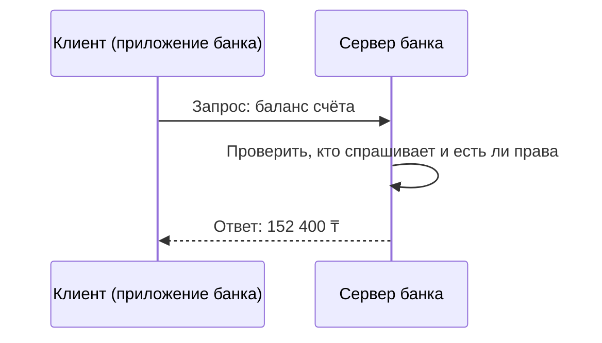

Систему строили год, а работать она будет десять лет. Как вы думаете, на что уйдёт больше денег: на создание или на всё, что случится после запуска? Сводные оценки по отрасли дают от 40 до 80% стоимости на время после релиза, чаще всего называют около 60%. Если вы думали, что главная работа заканчивается в день запуска, этот урок для вас.

---

## В этом уроке

- Что такое **жизненный цикл разработки (SDLC)** и почему это список вопросов, а не список коробочек
- **Инициация**: почему отменить проект в начале считается успехом
- **Требования** и **проектирование**: что строим и как именно
- **Разработка** и **тестирование**: что делает аналитик, когда код пишут другие
- **Развёртывание**: почему релиз проектируют так же тщательно, как функции
- **Сопровождение**: почему это в основном изменения, а не исправление ошибок
- **Оценка результата**: кто проверяет, выполнено ли обещание
- **Клиент и сервер**: схема, которая стоит за каждой системой, с которой вы будете работать

---

## Проблема

Заказчик говорит: «Нам нужна онлайн-запись к врачу». Разработчик готов начать писать код завтра утром.

Попробуйте перечислить, что должно быть известно до первой строчки кода. Сколько врачей? Как пациент находит свободное время? Что происходит, если он не пришёл? Кто вообще решил, что запись нужна, и как мы поймём, что она помогла?

На каждый из этих вопросов кто-то ответит. Вопрос только в том, ответят ли на него вовремя, осознанно и записав ответ, или разработчик решит сам, в два часа ночи, как ему удобнее.

---

## SDLC это последовательность вопросов, а не список этапов

Подумайте: если бы вам нужно было разбить создание системы на шаги, по какому принципу вы бы их выделили? По людям, которые работают? По документам?

Полезнее всего делить по **вопросам**, на которые нужно ответить, прежде чем двигаться дальше. Каждый этап отвечает на свой вопрос и заканчивается решением: продолжаем, меняем курс или останавливаемся.

**Жизненный цикл разработки (Software Development Life Cycle, SDLC)** это набор этапов, через которые проходит система от идеи до вывода из эксплуатации.

| Этап | Вопрос этапа | Что отдаёт аналитик |
|---|---|---|
| Инициация (Initiation) | Есть ли проблема, которую стоит решать, и окупится ли решение? | Список заинтересованных лиц, затронутые системы, измеримые цели |
| Требования (Requirements) | Что именно должна делать система? | Требования, ТЗ, User Stories с критериями приёмки |
| Проектирование (Design) | Как она будет устроена? | Модель данных, описание интеграций, контракты API, схемы |
| Разработка (Development) | Соответствует ли код тому, что задумали? | Ответы разработчикам, актуальная спецификация |
| Тестирование (Testing) | Работает ли система так, как описано? | Помощь QA, исправленные места в требованиях |
| Развёртывание (Deployment) | Как безопасно отдать систему пользователям? | Правила миграции данных, инструкции, описание релиза |
| Сопровождение (Maintenance) | Что меняем в работающей системе? | Анализ запросов на изменения и инцидентов |
| Оценка результата (Evaluation) | Получили ли мы то, что обещали? | Сравнение факта с целями, список улучшений |

Аналитик есть в каждой строке. Это важно, потому что в учебниках его часто рисуют только в начале.

Самая популярная аналогия для SDLC это строительство дома: фундамент, стены, крыша, отделка. Последовательность действительно похожа, и крышу правда нельзя положить раньше стен.

**Где аналогия ломается.** Дом сдают, и стройка заканчивается. Программа после сдачи живёт годами и постоянно меняется. Кроме того, передвинуть стену в готовом доме очень дорого, а изменить программу обычно гораздо дешевле. Именно поэтому в разработке есть подходы, где все этапы повторяются каждые две недели, а в строительстве так не делают.

> [!failure] Частое заблуждение: «SDLC это и есть водопад, этапы идут строго один за другим»
> **На самом деле:** SDLC описывает, *какие* вопросы нужно решить. *Как* их проходить, один раз подряд или маленькими кругами каждые две недели, определяет методология. В Agile-команде за один спринт проходят почти все этапы, только для маленького кусочка системы.
> **Почему так кажется:** почти везде этапы рисуют в виде лесенки слева направо, а у лесенки есть начало и конец.

Ещё одна деталь: в разных источниках этапов от пяти до восьми. ГОСТ 34.601-90, по которому до сих пор работают многие государственные и крупные проекты в странах СНГ, выделяет восемь стадий. Количество не важно. Важно, чтобы ни один вопрос из таблицы не остался без ответа.

> [!note] Буква «S» в SDLC исторически означала Systems, а не Software. Термин появился в 1960-х для больших систем обработки данных в бизнесе, когда «система» включала людей, бумажные процессы и компьютеры вместе.

> [!question]- Почему этапы полезнее описывать вопросами, а не названиями работ?
> **Ответ:** Потому что работа может выглядеть сделанной, а вопрос остаться открытым. «Требования собраны» звучит как готовый результат, но если никто не ответил «что происходит, когда пациент не пришёл», этап на самом деле не закончен. Вопрос позволяет проверить: да или нет.

---

## Инициация: самый дешёвый момент сказать «нет»

Когда отмена проекта считается успехом? Попробуйте ответить, прежде чем читать дальше.

На этапе **инициации** решают, стоит ли вообще начинать. Есть ли настоящая проблема, сколько примерно стоит её решение, что изменится для бизнеса и как это измерить.

Стив Макконнелл, автор известных книг по разработке, в статье 1998 года писал: информации для решения «продолжать или остановиться» обычно достаточно уже на 10–20% проекта. Отмена в этот момент, по его словам, должна считаться явным успехом. Для сравнения он приводит оценку Кейперса Джонса: в среднем отменённый проект в США отменяют, когда он уже опаздывает на год и потратил двойной бюджет.

Государственная служба Великобритании (GOV.UK) прямо пишет в своём руководстве: остановиться после этапа исследования это не провал, а сэкономленные время и деньги.

> [!tip] Аналитик на инициации отвечает за то, чтобы цели были **измеримыми**. «Улучшить запись к врачу» нельзя проверить. «Сократить число звонков в регистратуру на 30% за полгода» можно. Без такой цели на последнем этапе нечего будет сравнивать.

---

## Требования и проектирование: что строим и как

Чем «что» отличается от «как»? Подумайте на примере записи к врачу.

**Требования** отвечают на вопрос «что»: пациент видит свободные окна на ближайшие 14 дней, может отменить запись не позже чем за 2 часа, получает напоминание за сутки. Подробно о том, что такое хорошее требование, мы говорили в уроке [[why-analyst-exists|Зачем нужен системный аналитик]].

**Проектирование** отвечает на вопрос «как»: где хранится расписание, как наша система узнаёт о врачах из больничной системы, какие данные передаются при записи, что происходит, если больничная система не отвечает.

Граница между ними важна, потому что ошибка в «что» обнаруживается позже всех и стоит дороже всех.

### Lidl: семь лет и 500 миллионов евро на одном правиле учёта

В 2011 году немецкая сеть Lidl начала переводить учёт товаров на систему SAP. В 2018 году проект закрыли и вернулись к старой собственной системе. По данным немецкой прессы, потрачено было около 500 миллионов евро.

Одна из главных причин, которую называли журналисты: Lidl исторически ведёт учёт запасов по закупочным ценам, а стандартная SAP рассчитана на учёт по розничным. Это базовое правило бизнеса. Подгонка системы под него с участием сотен консультантов становилась всё дороже.

Честная оговорка: Lidl не публиковал полного разбора, а кроме этого правила были смена руководства и уход ИТ-директора в 2017 году. Но суть понятна и без подробностей: фундаментальное расхождение между тем, как работает бизнес, и тем, как устроена система, должно обнаруживаться на этапе требований, а не на седьмой год.

> [!question]- Пациент должен видеть свободное время врача. Это требование или решение проектирования? А «расписание забираем из больничной системы раз в 5 минут»?
> **Ответ:** Первое это требование: оно описывает, что получает пользователь, и не говорит, как это сделать. Второе это решение проектирования: оно описывает способ. Из него, кстати, сразу вытекает вопрос к требованиям: устраивает ли бизнес, что пациент может увидеть окно, которое занято последние 4 минуты?

---

## Разработка и тестирование: аналитик не уходит

Многие думают, что после передачи требований аналитик свободен. Как вы думаете, к кому идёт разработчик, когда в требованиях не описан какой-то случай?

На этапе **разработки** аналитик отвечает на вопросы разработчиков и обновляет спецификацию, когда решения меняются. Если спецификацию не обновлять, через месяц документ описывает одну систему, а работает другая.

На этапе **тестирования** тестировщики (QA, Quality Assurance) проверяют систему по требованиям. Аналитик помогает им понять требования, разбирает споры «баг это или так и задумано» и исправляет требования, если тестирование нашло в них дыру.

> [!tip] Спор «это баг или фича» почти всегда означает, что требование можно было прочитать двумя способами. Это сигнал для аналитика, а не для разработчика.

---

## Развёртывание: релиз тоже проектируют

**Развёртывание (Deployment)** это перенос готовой версии на рабочие серверы, где ей пользуются настоящие клиенты. На жаргоне: «выкатить в прод». **Прод (production)** это рабочая среда с настоящими пользователями и данными. **Стенд** это отдельная копия системы для разработки или тестирования. **Откат (rollback)** это возврат к предыдущей версии, если новая сломалась.

Звучит как техническая операция, которой занимаются только инженеры. Посмотрите на историю, где это оказалось не так.

### Knight Capital: 45 минут и 460 миллионов долларов

1 августа 2012 года американская торговая компания Knight Capital выкатила новую версию торговой программы. По данным Комиссии по ценным бумагам США (SEC), за первые 45 минут торгов система отправила на биржу более 4 миллионов заявок, пытаясь исполнить 212 заказов клиентов. Убыток превысил 460 миллионов долларов.

Обычно эту историю пересказывают как «один техник забыл обновить один сервер». Это правда, но это не вся правда. В отчёте SEC видна цепочка:

1. Новый код выкатывали вручную на восемь серверов. На восьмой его не скопировали, и второй человек это не проверял.
2. Новый код использовал старый служебный флажок. На восьмом сервере этот флажок включил функцию, которой не пользовались с 2003 года, но так и не удалили.
3. Эта старая функция была сломана ещё изменением 2005 года и не видела, что заявки уже исполнены.
4. До открытия биржи система разослала 97 автоматических писем с предупреждениями. На них никто не отреагировал.

Вывод для аналитика: риск релиза закладывается задолго до дня релиза. Неиспользуемая функция, которую не удалили, всё ещё работающий риск. А правила выкатки (кто проверяет, как убедиться, что все серверы одинаковые, как быстро откатиться) это тоже требования, которые кто-то должен описать.

> [!note] Контринтуитивный факт из ежегодного исследования DORA (2024): команды, которые выкатывают изменения чаще всего, ломают прод реже всех. Примерно 5% неудачных изменений у лучших команд против примерно 40% у отстающих. Это данные опроса, а не эксперимента, но объяснение логичное: маленькое изменение проще проверить и проще откатить.

---

## Сопровождение: большая часть жизни системы

Как вы думаете, чем в основном занимаются люди, которые «поддерживают» работающую систему? Чинят ошибки?

**Сопровождение (Maintenance)** это всё, что происходит с системой после запуска: исправления, доработки, адаптация к новым условиям. В 1980 году исследователи Лиенц и Свонсон опросили 487 организаций и выяснили, как распределяется работа по сопровождению:

- около 60% это **доработки**: новые и изменённые функции
- около 18% это **адаптация**: новая версия операционной системы, новый закон, новый формат данных
- около 17% это **исправление ошибок**

Позже Роберт Гласс свёл данные многих исследований в «правило 60/60»: сопровождение забирает от 40 до 80% стоимости программы (в среднем около 60%), и около 60% сопровождения это улучшения.

> [!failure] Частое заблуждение: «сопровождение это исправление багов»
> **На самом деле:** большая часть сопровождения это изменения функций, то есть новые требования к живой системе. Это работа аналитика, а не только разработчиков.
> **Почему так кажется:** слово «поддержка» звучит как ремонт, а ошибки заметнее и эмоциональнее доработок.

> [!warning] Вам наверняка встретится цифра «90% стоимости уходит на сопровождение». Первоисточника с таким измерением мы не нашли: её повторяют в блогах и статьях без ссылки на данные. Честная формулировка: «от 40 до 80%, чаще всего называют около 60%».

---

## Оценка результата: обещали X, получили ли?

Представьте, что систему запустили, она работает, пользователи ею пользуются. Проект успешен?

Не обязательно. Систему создавали ради цели, сформулированной на инициации. **Оценка результата (Post-Implementation Review, PIR)** проводится через несколько недель или месяцев после запуска, обычно от 6 недель до 6 месяцев. На ней сравнивают обещанное с полученным: достигнуты ли цели, получена ли выгода, сколько на самом деле стоило, что улучшить.

### Phoenix: должна была экономить 70 миллионов в год

В 2016 году правительство Канады запустило систему расчёта зарплаты госслужащим Phoenix. Она должна была экономить около 70 миллионов долларов в год. Вместо этого десятки тысяч сотрудников получали неправильную зарплату или не получали её вовсе, а затраты на исправление к 2023 году оценивали примерно в 2,2 миллиарда.

Генеральный аудитор Канады в отчёте 2018 года назвал проект «непостижимым провалом управления и надзора». Систему запустили без части критичных функций, без полного тестирования и без плана на случай сбоя. Руководство ставило сроки и бюджет выше работоспособности, а предупреждения из расчётного центра проигнорировали.

Вывод для аналитика: отчёт аудитора это и есть оценка результата, только внешняя и запоздалая. Он сравнил обещание (экономия) с фактом (миллиарды на исправление). Если такую оценку не проводит сама команда, рано или поздно её проведёт кто-то другой.

> [!question]- Почему оценку результата невозможно провести, если на инициации плохо сформулировали цель?
> **Ответ:** Потому что не с чем сравнивать. Если цель звучала как «улучшить запись к врачу», любой результат можно назвать улучшением. Если цель «сократить звонки в регистратуру на 30%», можно посчитать звонки до и после. Поэтому инициация и оценка связаны: первая задаёт вопрос, вторая на него отвечает.

---

## Клиент и сервер: роли, а не компьютеры

Откройте приложение банка и посмотрите на баланс. Как вы думаете, где на самом деле хранится эта цифра и кто решает, можно ли вам её увидеть?

Не в телефоне. Телефон только **попросил** её у другой программы и показал ответ.

Кто участвует:
- **Клиент (Client)**: программа, которая отправляет просьбу. Приложение на телефоне, сайт в браузере.
- **Сервер (Server)**: программа, которая принимает просьбу, проверяет права, достаёт данные и отвечает.
- **Запрос (Request)**: сообщение от клиента: «покажите баланс счёта такого-то».
- **Ответ (Response)**: сообщение от сервера: сумма или отказ.

*Обратите внимание на направление: разговор всегда начинает клиент. Сервер только отвечает.*

Классическая аналогия: ресторан. Вы (клиент) говорите официанту, что хотите, кухня (сервер) готовит, официант приносит блюдо. Вы не видите, что происходит на кухне, и вам это не нужно.

**Где аналогия ломается.** Официант помнит вас («вам как в прошлый раз?»). В обычном веб-взаимодействии каждый запрос должен нести всё нужное заново, сервер не держит разговор в голове. И кухня ресторана готовит для пары десятков столиков, а сервер одновременно обслуживает тысячи клиентов, поэтому вопросы нагрузки и времени ответа в аналогии не видны совсем.

> [!failure] Частое заблуждение: «клиент это телефон, а сервер это большой компьютер» или «клиент это frontend, а сервер это backend»
> **На самом деле:** клиент и сервер это **роли** в конкретном разговоре. Серверная часть банка становится клиентом, когда сама запрашивает данные у налоговой или у другого банка. Одна и та же программа в одном разговоре сервер, а в другом клиент.
> **Почему так кажется:** в самом первом примере, который все видят (телефон и банк), роли совпадают с устройствами.

Почему клиент-сервер стоит в уроке про этапы? Потому что на каждом этапе аналитик решает, что живёт на клиенте, а что на сервере. Проверять права на клиенте нельзя: клиент контролирует пользователь. Описывать запрос и ответ нужно на этапе проектирования. Время ответа под нагрузкой это требование, которое проверяют на тестировании и которое ломается в проде. Подробно механику разговора разберём в главе про API: [[api-fundamentals|Как устроена IT-система: Frontend, Backend, API]] и [[http-fundamentals|HTTP: как клиент и сервер реально разговаривают]].

> [!question]- Сервис доставки запрашивает у сервиса карт расстояние до адреса. Кто здесь клиент, а кто сервер? Почему ответ «доставка же backend, значит сервер» неверный?
> **Ответ:** Клиент это сервис доставки, потому что он отправляет запрос. Сервер это сервис карт, потому что он отвечает. То, что доставка сама является backend для приложения курьера, в этом разговоре не важно: роль определяется тем, кто спрашивает и кто отвечает в конкретном обмене.

---

## Типичная ошибка новичка

Считать, что работа аналитика заканчивается, когда требования переданы в разработку.

На практике дальше начинается не меньшая часть работы: ответы на вопросы, исправление требований по итогам тестирования, правила миграции данных к релизу, анализ запросов на изменения в сопровождении и оценка результата. Аналитик, который «отдал ТЗ и ушёл», через три месяца обнаруживает, что система работает не так, как он описал, а документ никто не обновлял.

---

## Module Check

> [!question]- **1. True/False + explain.** «SDLC и Waterfall это одно и то же».
> **Ответ:** False. SDLC перечисляет вопросы, которые нужно решить в жизни системы: что строим, как, проверено ли, как выкатить, как менять, получили ли результат. Waterfall это один из способов пройти эти этапы: по одному разу, строго по порядку. В Agile те же этапы проходят маленькими кругами каждый спринт.

> [!question]- **2. Use-case.** Через три месяца после запуска онлайн-записи руководство спрашивает: «Ну что, система себя оправдала?» Какой этап SDLC сейчас идёт и что вам нужно, чтобы ответить?
> **Ответ:** Оценка результата (PIR). Нужна измеримая цель, поставленная на инициации (например, «минус 30% звонков в регистратуру»), и данные до и после запуска. Если цели не было, честный ответ «мы не можем это проверить», и это урок на следующий проект.

> [!question]- **3. Spot the bug.** План проекта: «Инициация, требования, проектирование, разработка, тестирование, релиз. Проект завершён». Чего не хватает и почему это опасно?
> **Ответ:** Нет сопровождения и оценки результата. Сопровождение забирает большую часть стоимости и в основном состоит из изменений, то есть из работы с требованиями, а в плане на неё нет ни людей, ни денег. Без оценки результата никто не узнает, достигнута ли цель, ради которой проект начинали.

> [!question]- **4. Compare.** Чем требование отличается от решения проектирования? Приведите по одному примеру для записи к врачу.
> **Ответ:** Требование описывает, что система делает для пользователя («пациент может отменить запись не позже чем за 2 часа»). Решение проектирования описывает, как это устроено («отмена отправляет запрос в больничную систему, при отсутствии ответа за 10 секунд показываем ошибку и сохраняем запись»).

> [!question]- **5. Почему?** Почему история Knight Capital это история не только про ошибку техника в день релиза?
> **Ответ:** Потому что риск создали раньше: старую функцию не удалили при сопровождении, новый код использовал старый флажок (решение проектирования), выкатка шла вручную без проверки вторым человеком, а 97 предупреждений никто не прочитал. Ошибка техника стала последней каплей в цепочке, которую можно было разорвать на любом шаге.

> [!question]- **6. Повторение.** Из урока «Зачем нужен системный аналитик»: на каком этапе SDLC слово «быстро» в требовании должно превратиться в цифру и какой этап пострадает, если этого не сделать?
> **Ответ:** На этапе требований: «быстро» нужно заменить проверяемым значением («список открывается не дольше 2 секунд»). Если этого не сделать, первым пострадает тестирование, потому что нельзя проверить «быстро», а потом прод, где под нагрузкой выяснится, что «быстро» все понимали по-разному.
